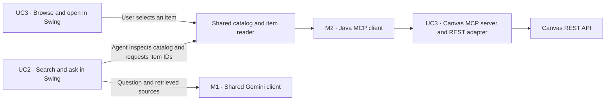

# CSC207 Team Project - Project Blueprint

> **Status:** Draft for team review  
> **Last revised:** November 25, 2026
>
> **Branch for proposed changes:** `test`  
> **Ownership:** Rosalind Zhou (`@RosalindZhou`) leads M1 and UC3. Chris Li (`@chrislxn`) leads M2 and UC2. Yue Tang leads M4 and UC1, and Ran Yan leads UC5. See [Team Work Split](TEAM_WORK_SPLIT.md).

## 1. Project Overview

**Working title:** MCP-first Academic Assistant (final name TBD)  
**Domain:** Education / Academic Productivity  
**Platform:** Java desktop application with a Swing GUI

The project helps university students find and understand information dispersed across Canvas LMS courses. Instead of requiring students to browse many course Pages, PDFs, assignments, and announcements, the application provides an AI assistant that uses Model Context Protocol (MCP) tools to retrieve relevant course information **on demand**. A small, local-only To-Do list lets students manage their own tasks without integrating Outlook or Microsoft To Do.

The MVP is intended to demonstrate meaningful software design, teamwork, Java/Swing implementation, external API integration, and data persistence. It is **not** a production-ready general-purpose LMS client.

### Core design principle: MCP-first

The AI agent decides which approved read-only tool to call in response to a user's question. Course information is fetched as needed through an MCP interface backed by Canvas. The application does not require all LMS information to be downloaded or added to every prompt before the user can ask a question.

## 2. MVP Scope

| Priority | Feature | Notes |
| --- | --- | --- |
| P0 | Java Swing application and Clean Architecture | Mandatory course design direction |
| P0 | AI tool-calling loop | The model chooses relevant catalog items, and Java dispatches approved item reads |
| P0 | Canvas access through MCP | UC3 provides a shared course catalog and on-demand reads through the Java Canvas MCP server |
| P0 | Browse Canvas course content in UC3 | Preview custom HTML or show native Modules, and open sources through the appropriate view |
| P0 | Local To-Do with persistence | Owned by one member as a complete feature |
| P0 | Search and ask about Canvas resources in UC2 | Answer from Pages and PDFs and cite the sources actually read |
| P0 | Saved course resources in UC4 | Save, reopen, and remove source links |
| P0 | Announcement summaries | Dated summaries with Canvas source links |
| P0 | Upcoming-deadline briefings | Canvas assignments; optional inclusion of local tasks |
| Out | Outlook / Microsoft To Do synchronization | Local To-Do only |
| Out | Canvas write operations, autonomous submissions, or message posting | Read-only MCP tool allowlist |
| Out | Background system notifications, full LMS mirroring, OCR and vector database | Not required for MVP |

**Scope rule:** UC1–UC6 form the MVP. Each of the six members leads at least one use case.

## 3. Proposed User Stories and Use Cases

UC3 lets students browse and open Canvas content. UC2 searches the same catalog and uses it for Page and PDF questions.

| ID | User Story | Use Case | Priority | Lead |
| --- | --- | --- | --- | --- |
| UC1 | As a student, I want to manage my personal study tasks without switching between apps, so I can keep track of my work. | **Manage Local To-Do** | P0 | **Yue Tang (`@happy-soup`)** |
| UC2 | As a student, I want to search course resources and ask about Pages or PDFs, so I can get answers that cite the relevant material. | **Find and Ask About Canvas Resources** | P0 | **Chris Li (`@chrislxn`)** |
| UC3 | As a student, I want to browse a course's available resources and open an item, so I can find content across different Canvas layouts. | **Browse and Read Canvas Course Content** | P0 | **Rosalind Zhou (`@RosalindZhou`)** |
| UC4 | As a student, I want to save useful course sources, so I can reopen them without repeating a search. | **Save and Reopen Course Resources** | P0 | TBD |
| UC5 | As a student, I want a summary of recent course announcements, so I can identify important updates. | **Summarize Announcements** | P0 | **Ran Yan (`@Asp-hyxia`)** |
| UC6 | As a student, I want a briefing of approaching deadlines, so I can prioritize my academic work. | **Generate Deadline Briefing** | P0 | TBD |

### UC1 - Manage Local To-Do

- **Input:** task title, optional due date, and a requested action (create, view, complete, reopen, or delete).
- **Success:** the action updates the local task list and persists between application launches.
- **Failure:** blank/invalid title, invalid date, or missing task results in a clear error.
- **Boundary:** no Microsoft Graph, Outlook, or third-party To-Do synchronization.

### UC2 - Find and Ask About Canvas Resources (Lead: Chris Li)

- **Input:** a selected course and a search query or question, with optional configured defaults and selected Page or PDF IDs.
- **Success:** search returns matching catalog entries. For questions, the agent uses configured and selected references, reads whole items by ID, and can choose relevant additional entries from the shared catalog. Swing displays the answer and original links for the sources used.
- **Failure:** report empty search results, inaccessible sources, unsupported files or size limits, insufficient evidence, and model or service errors.
- **Integration:** Chris owns UC2's UI, prompts, source selection, reading limits, and Page/PDF model input. UC2 uses Rosalind's shared M1 Gemini client and the UC3 content contract over MCP.
- **Acceptance:** ask about a selected Page or PDF. With a fixture question that requires another item, verify the agent finds it in the catalog and cites both sources. A question answered by the initial item should finish with one read.

### UC3 - Browse and Read Canvas Course Content (Lead: Rosalind Zhou)

- **Input:** add a course by URL and Canvas connection, or open a configured course. Then follow a Page link, expand a module, or open a resource.
- **Success:** Swing renders a custom home as HTML or shows Modules in a native list. Links to supported Pages from the HTML preview continue in that pane. Files and Page or file rows in Modules open in the browser. The catalog combines Page and PDF metadata from course discovery routes.
- **Failure:** distinguish an empty catalog from a partial catalog or access failure. Report an inaccessible item when selected and keep the other available entries visible.
- **Integration:** Rosalind owns UC3's browsing UI and the Canvas REST adapter and MCP tool handlers for the shared catalog and authorized item reads.
- **Acceptance:** follow a Page link inside a custom HTML home, then expand Modules and open a module resource in the browser. Verify that a UC2 read of the same resource succeeds by catalog ID.

See the [UC3 browsing and navigation design](docs/UC3_CANVAS_BROWSING.md) for course setup, rendering, link routing, and detailed acceptance scenarios.

### UC4 - Save and Reopen Course Resources

- **Input:** save a source from search results or an answer citation, or select a saved source to open or remove.
- **Success:** saved titles and links survive a restart. Opening a saved link takes the student to the original Canvas source.
- **Failure:** report an invalid link or local persistence error.
- **Boundary:** store source metadata locally. Canvas checks access when the link is opened.

### UC5 - Summarize Announcements

- **Input:** selected course(s) and a recent time window.
- **Success:** the agent retrieves permitted announcements and presents a concise, dated summary with source links and actionable items.
- **Boundary:** do not claim an announcement is current without checking its retrieval time.

### UC6 - Generate Deadline Briefing

- **Input:** requested period (for example, the next seven days).
- **Success:** the program reads assignments and due dates via MCP, orders them by actual deadline, and displays an informative briefing. A local task list may be included if time permits.
- **Boundary:** suggestions are not official course deadlines; ordering and filtering should be independently testable without an LLM.

## 4. Domain Model (Initial)

| Entity / value object | Suggested fields                                | Purpose                                                     |
|-----------------------|-------------------------------------------------|-------------------------------------------------------------|
| `Task`                | `id`, `title`, `dueAt`, `completed`             | Locally persisted personal task and its completion behavior |
| `Course`              | `id`, `name`, `courseCode`                      | A course returned by Canvas                                 |
| `CourseResource`      | `id`, `courseId`, `title`, `type`, `sourceUrl`  | Catalog metadata for a Canvas Page or file                   |
| `AcademicDeadline`    | `id`, `courseId`, `title`, `dueAt`, `sourceUrl` | Due dates for briefing and presentation                     |
| `SourceReference`     | `title`, `url`                                  | Value object attached to AI answers                         |

These are application models, **not** the raw JSON structures returned by Canvas or MCP. Do not add fields and classes until a Use Case requires them. We should document class attributes and relevant methods in the README or an accompanying UML class diagram before the final presentation.

## 5. Architecture and Modules

Each Swing flow goes through its Controller, Interactor, Presenter, and ViewModel. UC2 and UC3 share the content contract and run through separate input boundaries.

### Modules and interfaces

| Module                                   | Description                                                                                        | Main interface / integration point  | Owner                               |
|------------------------------------------|----------------------------------------------------------------------------------------------------|-------------------------------------|-------------------------------------|
| **M1 - AI Agent Core**                   | Shared Gemini requests, tool-call protocol, and provider error handling | `AgentGateway` | **Rosalind Zhou (`@RosalindZhou`)** |
| **M2 - MCP Client Integration**          | Java MCP client and integration with UC3's catalog and read contracts | `McpToolGateway` | **Chris Li (`@chrislxn`)** |
| **M3 - Document Handling**               | PDF validation and document handoff | `DocumentGateway` (planned) | TBD |
| **M4 - Local Storage & To-Do**           | Task Entity, local persistence, task operations                                                    | `TaskRepository`                    | **Yue Tang (`@happy-soup`)**        |
| **M5 - Swing Frontend**                  | Chat, resource, task and results views; ViewModels and application UI conventions                  | Controllers / Presenters / Views    | TBD                                 |
| **M6 - Academic Features & Integration** | Announcement/deadline workflows, shared composition / AppBuilder, demo integration                 | Use Case boundaries and AppBuilder  | TBD                                 |

**Ownership model:** Every person should have a primary shared module responsibility **and** lead a complete user-facing Use Case. Technical module ownership is not a substitute for CSC207's individual Use Case leadership requirement. Feature teams may contribute changes across modules, subject to review.

### Clean Architecture rules

1. Interactors depend on interfaces, not on concrete LLM SDKs, Python, HTTP, or Swing classes.
2. Controllers translate user input to Input Data; Presenters translate Output Data to ViewModels.
3. The shared agent and MCP connection are implemented once and reused, not rewritten for each AI feature.
4. External API DTOs and parsing logic belong in gateway adapters, not Entities.
5. Network and model calls must not block Swing's Event Dispatch Thread.
6. Views can share UI components, while Use Cases retain clear inputs, success/failure paths, and tests.

### Shared course content contract

The following operations describe the planned application interface. UC3 supplies the catalog and reads, and M2 maps them to the Java MCP client.

| Operation | Input | Result |
| --- | --- | --- |
| `listContent` | `courseId`, optional `parentId`, and optional pagination cursor | The shared catalog or the requested branch. Include `contentId`, title, type, canonical source URL, locations, and any continuation cursor or coverage warnings. |
| `readContent` | `courseId` and `contentId` | Authorized Page content or PDF with its title and canonical source URL. Return a typed error for denied access, an unavailable item, unsupported content, or a service failure. |

Start from the existing `CourseResource` and `ResourceListing` metadata. Deduplicate items across discovery routes by course, resource type, and resource ID, retaining module locations. An empty home leaves the Pages, Files, and Modules discovery routes available. Modules organize Page and PDF entries. Announcement and assignment entries can be added through the existing UC5 and UC6 retrieval paths if the catalog expands.

The catalog holds metadata. In-app Page previews and the agent read item contents on demand. Browser actions use the Canvas source links. The server validates course scope and item permissions for every read. For the MVP, UC2 searches one selected course and reads up to three distinct items per question. Apply that limit to the combined default, selected, and agent-chosen references. Show the limit before submission if configured and selected references already exceed it. UC2 assembles citations from the items actually read.

### Other shared contracts

- `AgentGateway`: shared model access for questions with retrieved Page or PDF content and approved tools. M1 and UC2 agree on model input formats and error mapping.
- `McpToolGateway`: `listTools()` and `callTool(name, args)` provide controlled access to approved MCP functions.
- `TaskRepository`: save, find, list and delete local tasks.
- `DocumentGateway`: planned PDF handoff between authorized retrieval and model input.
- `Clock`: current date/time for deterministic deadline logic, if needed.

The current Java prototype exposes `list_courses`, `list_resources`, and `read_page`. The unified catalog, PDF reads, and model-selected additional reads are planned extensions.

## 6. API Integration, Persistence and Security

**Canvas.** UC3 owns the read-only Canvas REST adapter and Java MCP tool handlers. M2 integrates the Java client. See the [Canvas developer documentation](https://developerdocs.instructure.com/services/canvas).

**LLM provider.** M1 supplies the shared Gemini client. The current prototype supports Page answers. The revised UC2 also needs PDF input and tool requests for additional catalog items.

**Local persistence:** Personal To-Do data and saved resource metadata can use JSON or another simple local format behind DAOs. A Canvas cache is optional and should be on demand, associated with source and fetch timestamps; stale content must be distinguishable from freshly retrieved information.

**Security constraints:** Never commit Canvas or LLM tokens, `.env` files containing secrets, downloaded private course material, or cached credentials. Keep Canvas tools read-only. Use an allowlist of permitted tool calls. Treat LMS text and PDF content as untrusted data; it must not override program safety rules or authorize extra operations.

## 7. UC2 and UC3 Demonstration

1. In UC3, open the course and follow a Page link in the custom HTML home. Swing shows the Page preview and its original Canvas link. In a Modules-based course, expand a module and open a resource in the browser.
2. Select the Project Timeline as a reference and ask a question in the UC2 panel.
3. UC2 reads the selected source along with any configured default references. If the question needs information about evaluation, the agent can choose Project Expectations from the same catalog.
4. Swing shows the answer and links to the retrieved sources. Repeat with a permitted PDF to verify the document path.

Use fixture catalogs to verify browse, access errors, and the choice to read another item. Use a live smoke test to verify the Canvas and Gemini integrations.

## 8. Testing and Course Timeline

| Date              | Milestone                                 | Evidence                                                                                                                                                      |
|-------------------|-------------------------------------------|---------------------------------------------------------------------------------------------------------------------------------------------------------------|
| **Nov 20, 2026**  | Individual progress and working prototype | Each member: substantial PR, review of at least one teammate PR, runnable assigned work; team: a working external API call and at least one complete Use Case |
| **Nov 27, 2026**  | Near-complete MVP                         | MVP integrated, at least one unit test per Interactor                                                                                                         |
| **Dec 4, 2026**   | Final polish                              | 100% line coverage for Entity and Use Case layers; resolved bugs; presentation practice                                                                       |
| **Dec 7-8, 2026** | Final presentations                       | Demonstrate MVP; all members explain their own work and design decisions                                                                                      |

Course sources: [Project Timeline](https://q.utoronto.ca/courses/444184/pages/project-timeline-2), [Project README and MVP guidance](https://q.utoronto.ca/courses/444184/pages/project-readme-and-minimum-viable-product-mvp), [Project Expectations](https://q.utoronto.ca/courses/444184/pages/project-expectations).

## 9. Decisions Needed from the Team

- [ ] Confirm the actual team size and the final number of MVP Use Cases.
- [ ] Review the acceptance criteria for the six MVP use cases.
- [ ] Assign every remaining Module Owner and Use Case Lead (`TBD` entries).
- [ ] Agree on MCP payloads for the shared catalog and item reader, including pagination and source permissions.
- [ ] Confirm Gemini PDF input and model-driven reads against the shared content contract.
- [ ] Agree on the shared Java interface signatures and error response types.
- [ ] Decide the local To-Do storage format and whether optional Canvas caching belongs in the MVP.

**Related document:** [Team Work Split](TEAM_WORK_SPLIT.md).
