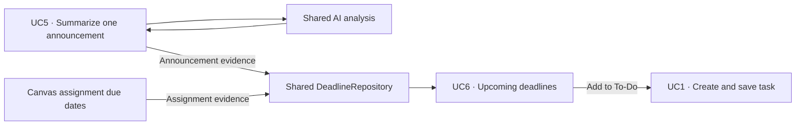

# Announcements, deadlines, saved sources, and To-Do

This planned design covers UC1, UC4, UC5, and UC6 and their handoffs with UC2 and UC3. Students can browse announcements and upcoming deadlines on one Swing Dashboard. Saved sources and To-Do each have their own view.

## UC1 — Manage local To-Do

**Lead** Yue Tang. The student opens To-Do and can create, complete, reopen, or delete a personal task. The task list is saved locally and restored on restart.

UC6 can also invoke the UC1 create-task boundary when the student clicks **Add to To-Do**. The request contains a title, due date or time, source link, and stable `deadlineId`. UC1 validates and saves the task using its repository. It returns whether a task was created or already exists, so UC6 can mark the row **Added to To-Do**. Repeating the action keeps a single task for that deadline. Tasks created directly in UC1 need only a title and may have a personal due date.

Adding a deadline creates a personal task with the displayed due value. The student manages that task in UC1. Later changes to source evidence are shown in UC6, and the student can update their personal task in UC1.

## UC4 — Save and reopen course resources

**Lead** Sophia Yang. The student clicks **Save** on a catalog entry in UC3 or a source citation in UC2. UC4 receives the title and canonical Canvas link, saves the reference locally, and shows the saved state. Saving the same link again keeps one reference.

The **Saved** view lists these references after restart. The student can open one in the browser or remove it from the list. The saved record contains link metadata, and Canvas applies its normal access rules when the link opens.

## UC5 — Summarize announcements and discover deadlines

**Lead** Ran Yan. The Dashboard shows recent authorized announcements in a separate group for each configured course. An announcement row shows its title, posting date, Canvas link, and a **Summarize** button. Each course group can display its own loading or access error so other courses remain usable.

1. The student clicks **Summarize** on one announcement. The UC5 Controller passes its course and announcement IDs to the UC5 Interactor, which retrieves the selected announcement body through the shared Canvas read adapter.
2. UC5 calls the planned shared announcement analysis operation with that announcement. Chris owns the shared AI module. UC5 can wait on a worker thread for the final summary and zero or more structured deadline candidates with their supporting wording. See the [shared AI interface](SHARED_ENTITIES_AND_INTERFACES.md#shared-ai-calls-and-streaming).
3. UC5 validates the candidates against the retrieved text, adds usable evidence to the shared deadline repository, and sends the result to its own Presenter. Swing shows the summary under that announcement. UC6 can then show the new dates in its timeline.
4. If a model request fails, show retry on the announcement row. If the summary succeeds and saving a deadline fails, show the summary and report the save failure. Repeating the request can safely update the same evidence.

Weekly briefings are ordinary announcement inputs. An announcement can contain several deadlines, one deadline, or none. Extraction runs when a student requests a summary in this MVP.

## UC6 — Generate a deadline briefing and add tasks

**Lead** Anqi Feng (`@fbgfaqzxm1003`). The student opens **Upcoming deadlines** in the Dashboard and selects a date range. UC6 reads Canvas assignment due dates for the selected courses through the shared Canvas adapter. It records that evidence in the same deadline repository that UC5 uses for announcement-derived dates.

1. Query the shared deadline repository for the requested courses and dates. Show a single timeline in due-date order with the course, item, due date or time, and original source links.
2. Label evidence as **Canvas assignment** or **From announcement**. Show conflicting dates with both sources and a **Needs review** status. Preserve a date-only deadline as a date. A candidate with no resolvable date can appear in a separate **Needs review** group.
3. For a row with a usable due date, the student can click **Add to To-Do**. Call the UC1 create-task boundary with the displayed date and source information. The UC6 Presenter shows the outcome while UC1 owns the saved task.
4. If a course's assignment retrieval fails, show the existing evidence and identify that course's results as partial.

UC6 owns date filtering, ordering, reconciliation, and the deadline timeline. These operations use typed deadline records from the repository. UC5 owns each announcement card and invokes the model once for a summary and extraction.

## Shared deadline records and interfaces

The shared repository is the app's source of truth for its deadline list. Each `AcademicDeadline` has a stable ID, course ID, title, due date or time when known, and source evidence. Evidence records the source kind, Canvas source ID or link, reported due value, and the relevant wording for announcement-derived dates. Source links let students verify dates against Canvas.

- Match evidence within the same course. A matching Canvas assignment ID or canonical assignment link can associate an announcement with the assignment's deadline record. Keep the deadline ID stable when adding evidence to an existing record.
- Make reprocessing an announcement or refreshing an assignment idempotent. Associate a repeated observation with the same source and deadline. When the match is uncertain, flag it for review.
- Keep evidence from each source when dates disagree. Show conflicting values and reserve **Add to To-Do** for rows with a usable date. Preserve date precision when handing it to UC1. If relative wording cannot be resolved from the source, record it for review with the original wording.

| Contract | Handoff |
| --- | --- |
| Shared Canvas reads | UC3 supplies the authenticated Canvas adapter. UC5 reads announcements and UC6 reads assignment due dates through their own data interfaces. |
| Announcement analysis | A Java interface receives one announcement and returns a summary plus deadline candidates. UC5 sends the returned summary through its own Presenter. |
| `DeadlineRepository` | UC5 submits announcement evidence. UC6 submits assignment evidence and queries the merged timeline. Use a local repository that survives restart. |
| UC1 create-task boundary | UC6 passes the deadline ID, title, due value, and source. UC1 saves the task and returns a creation or already-existing result. |
| Saved-source input | UC2 and UC3 can pass a title and source link to UC4. UC4 owns the saved links and their UI. |

## Acceptance examples

| Scenario | Expected result |
| --- | --- |
| A weekly announcement lists dates for two assignments | One click summarizes the announcement and adds two sourced entries to the timeline. |
| A due date exists only in a processed announcement | The date appears in UC6 with the announcement link and supporting wording. |
| The same assignment is present in Canvas and an announcement | The row retains both sources. Conflicting dates are visible for review. |
| A student adds a deadline twice and restarts | UC1 shows one saved task with the source link. UC6 can show that the deadline has already been added. |
| The student saves a course resource and restarts | UC4 can reopen its Canvas link and remove the saved reference. |
